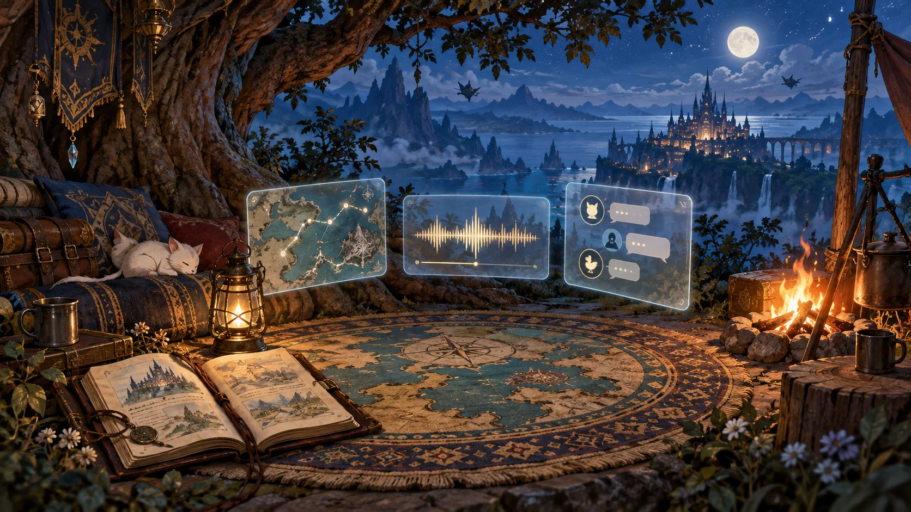
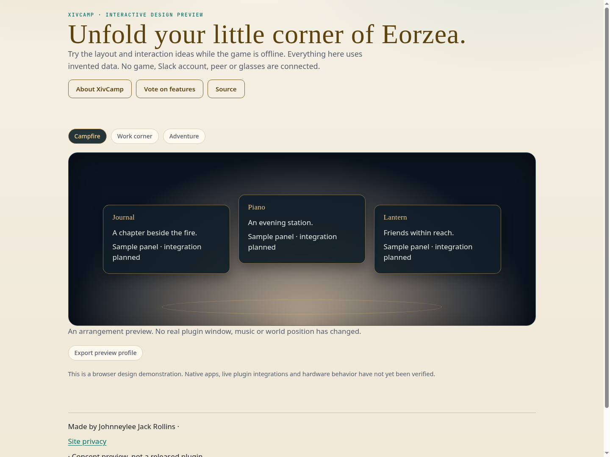

# XivCamp

Unfold your little corner of Eorzea.

A saved-layout project for your map rug, journal, music, conversations and world windows. Make a campfire, work corner or adventure arrangement and return to it.



**Status: interactive design preview.** The source builds a browser preview with invented data. There is no installable Dalamud release, live game integration, or verified hardware support yet. The illustration is AI-generated concept artwork, not a screenshot or hardware photograph.

[Project site](https://spacegho.st/mods/ffxiv/xivcamp/) · [Try the preview](https://spacegho.st/mods/ffxiv/xivcamp/preview/) · [Vote on features](https://spacegho.st/mods/ffxiv/xivcamp/vote/) · [Roadmap](ROADMAP.md) · [Architecture](docs/architecture.md)

## Build and run the preview

Node 22 or later is required. Authored browser code and build tooling are native Imba, precompiled to committed JavaScript. Third-party compiler dependencies remain unchanged.

```sh
npm ci --ignore-scripts
npm run build
npm run check
npm test
python3 -m http.server 8080 --directory preview
```

Open `http://localhost:8080`. The preview connects to no game, Slack account, network peer or glasses. It uses no credentials. Draft/profile exports describe preview state only.

## Browser preview capture



Captured in Chromium. This is a design demonstration, not a live game or account connection.

## Planned experience

- **A place for the tools you already have.** Campfire brings Rug, Piano, Journal and Lantern together. Work corner adds Dispatch, notes and a terminal. Adventure favours Wayfinder and compact Prism information. Each arrangement remembers what belongs there.
- **Begin on the screen.** The first implementation target is a saved screen layout: panel selection, position, size and display assignment. The interactive preview switches invented arrangements and exports a draft. It does not move real plugin windows.
- **Then unfold it into the world.** Ghostty world windows and Rug placement are later integrations. A scene should retain an ordinary screen recovery path whenever a world host is missing or unavailable. A picture of a campsite is concept artwork, not evidence that furniture is being spawned.
- **One arrangement, several displays.** With Prism, a Camp arrangement can send navigation to glasses, a journal to a tablet and work conversations to another monitor. Display mappings remain owned by the receiving client.
- **Controller-friendly and reversible.** Opening Camp should have explicit focus ownership. Closing it, switching scenes or losing an optional provider should restore the previous arrangement. Missing panels should be reported individually rather than breaking the whole scene.
- **What still needs proving.** Live window ownership, restoring positions, world placement, music actions and controller navigation need acceptance with the actual modules. There is no live plugin integration or installable Dalamud release in this publication.

## Publication and validation

The canonical website registry and ballots are maintained in [ghostty-vote](https://github.com/Spaceghost/ghostty-vote). `metadata/project.json` records this project's identity and honest publication state. `metadata/feature-catalogue.json` mirrors the initial public ballot. No release archives or plugin installer entries are published for this preview.

The CI verifies precompiled output and builds the browser preview. Real game, account, display, hotplug and input checks remain acceptance work, tracked in the roadmap.

Made by Johnneylee Jack Rollins. An independent fan project, not affiliated with Square Enix or hardware/service vendors. Source is MIT licensed; generated artwork attribution is in `docs/art/provenance.json`.
